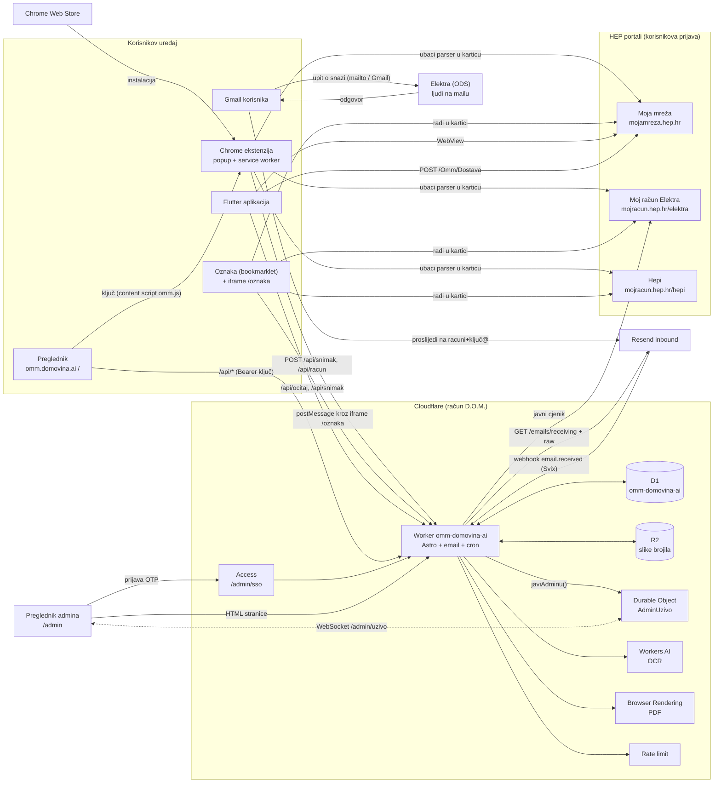
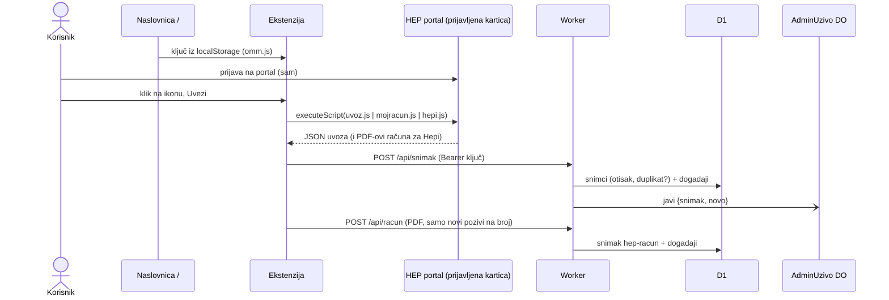
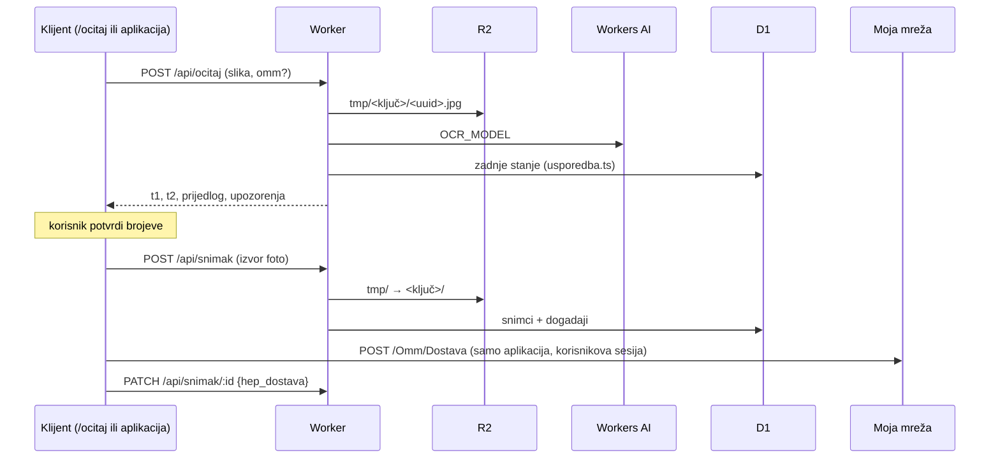
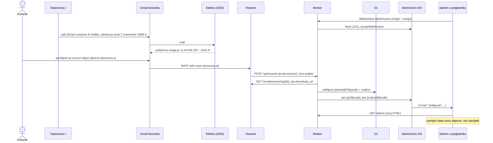
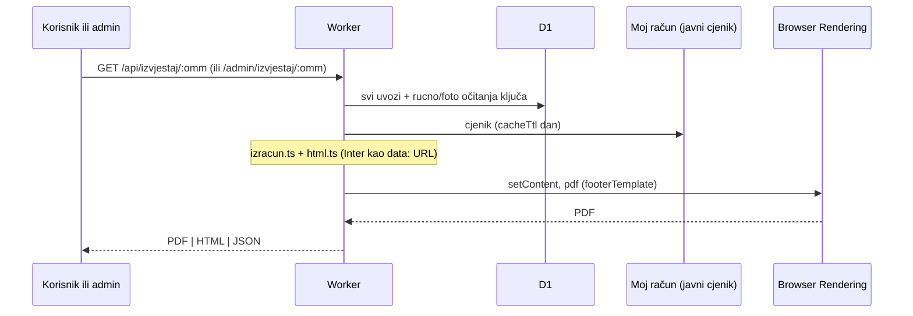
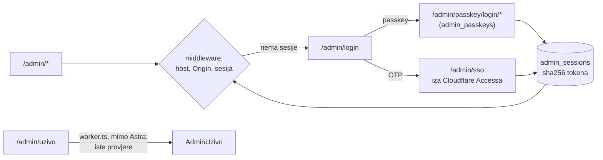
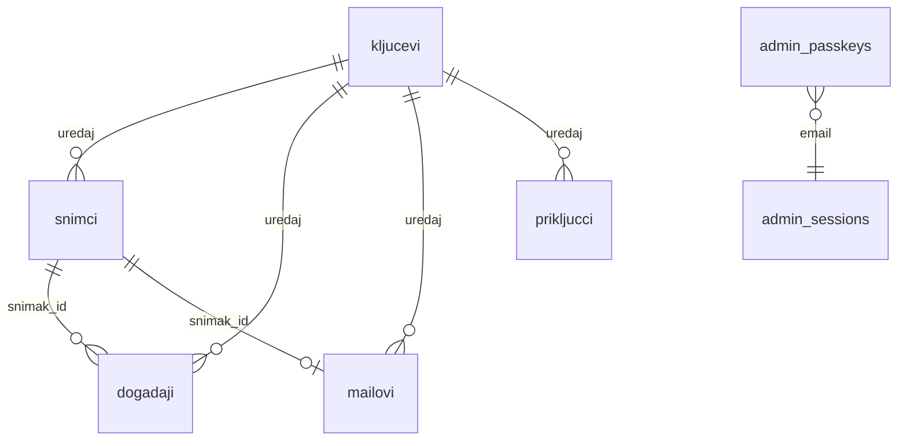

# Arhitektura: sve komponente i njihovi odnosi

Stanje 2026-11-03. Pregled cijelog sustava na jednom mjestu. Detalji pojedinih tokova su
u dokumentima iz „Vezani dokumenti” na kraju; ovdje je samo tko s kim razgovara, čime i zašto.

Dva pravila oblikuju sve ispod:

1. **Server nikad ne ulazi na HEP-ove portale** i ne vidi HEP-ove kolačiće. Podatke s
   Moje mreže, Mojeg računa i Hepija čita kod koji radi u korisnikovoj prijavljenoj
   kartici (ekstenzija, oznaka, aplikacija) i šalje ih na `omm.domovina.ai`.
   Jedina iznimka je javni cjenik HEP Elektre, za koji prijava ne treba.
2. **Nema korisničke prijave.** Klijent ima nasumični ključ uređaja i šalje ga kao
   `Authorization: Bearer <ključ>`. Prijavu ima samo admin (Cloudflare Access ili passkey).

## Komponente

| # | Komponenta | Gdje živi | Uloga |
|---|---|---|---|
| 1 | Preglednik: naslovnica `/`, `/ocitaj`, `/privatnost` | Astro SSR stranice, ključ u `localStorage` | korisnik dobije ključ, instalira ekstenziju ili oznaku, vidi snimke, preuzme izvještaj, šalje upit Elektri |
| 2 | Preglednik: `/admin` | Astro SSR + `uzivo-klijent.ts` | pregled svih OMM-ova, izvještaj za bilo koji ključ, osvježava se uživo |
| 3 | Chrome ekstenzija „HEP uvoz” | `flutter_moja_mreza/extension`, Web Store `eaepdcjo…` | glavni put uvoza (od 2026-10-30): popup ubaci parser u HEP-ovu karticu, service worker šalje na API |
| 4 | Oznaka (bookmarklet) „Uvezi iz HEP-a” | `/hep-uvoz.js` (generiran u `flutter_moja_mreza`) + iframe `/oznaka` | rezervni put za preglednike bez ekstenzije |
| 5 | Flutter aplikacija | `flutter_moja_mreza/example` | uvoz u WebViewu, fotografija brojila, dostava očitanja HEP-u |
| 6 | HEP Moja mreža (ODS) | `mojamreza.hep.hr` | OMM-ovi, očitanja, potrošnja; `POST /Omm/Dostava` za predaju očitanja |
| 7 | HEP Moj račun (Elektra) | `mojracun.hep.hr/elektra` | kupci, saldo, očitanja; javni cjenik |
| 8 | HEP Hepi (Opskrba) | `mojracun.hep.hr/hepi` | računi u PDF-u, očitanja |
| 9 | Cloudflare Worker `omm-domovina-ai` | `src/worker.ts` (Astro `handle` + `email` + `scheduled`) | sav HTTP, API, admin, webhook, cron |
| 10 | D1 `omm-domovina-ai` | `migrations/` | sve trajne tablice (vidi „Podaci”) |
| 11 | R2 `omm-domovina-ai-slike` | `<ključ>/<uuid>.jpg`, `tmp/` | slike brojila; lifecycle briše `tmp/` nakon dana |
| 12 | Durable Object `AdminUzivo` | `src/lib/admin/uzivo.ts` | WebSocketi otvorenih admin stranica; javlja svaki upis |
| 13 | Workers AI | `OCR_MODEL` (llama-4-scout) | čitanje zaslona brojila |
| 14 | Browser Rendering | `BROWSER` | PDF izvještaja potrošnje |
| 15 | Rate limiting | `LIMIT_API`, `LIMIT_SKUPO` | zaštita `/api/*` i skupih ruta |
| 16 | Cloudflare Access | `domovina.cloudflareaccess.com`, samo `/admin/sso` | admin prijava OTP-om (druga je passkey) |
| 17 | Resend (inbound) | MX `omm.domovina.ai` → `receive-euw1.forge.rmta.net` | prima mail na `racuni+<ključ>@omm.domovina.ai`, javlja webhookom |
| 18 | Korisnikov Gmail (ili drugi sandučić) | korisnikov račun | šalje upit Elektri, prima odgovor i račune, prosljeđuje ih na `racuni+<ključ>@` |
| 19 | Elektra (ODS područje, 21 komad) | mail adrese u `src/lib/prikljucak.ts` | ljudi odgovaraju na upit o priključnoj snazi |
| 20 | Chrome Web Store | `chromewebstore.google.com` | distribucija ekstenzije |

## Cjelina

## Tokovi

### 1. Uvoz s HEP-a ekstenzijom (glavni put)

Ključ nastaje na naslovnici i živi u `localStorage`; content script `omm.js` ekstenzije ga
preuzme (i postavi `data-omm-ekstenzija`, po čemu naslovnica zna da je ekstenzija tu).
Slanje ide s origina ekstenzije, pa HEP-ov CSP i COOP ne smetaju.

### 2. Uvoz oznakom (rezerva)

HEP-ov CSP priječi fetch i `<script>` s tuđeg origina, a COOP (od 2026-10-30) popup. Zato
oznaka ubaci skriveni iframe `/oznaka`, jedinu stranicu s `frame-ancestors` HEP-ovih
portala; on pošalje kod `/hep-uvoz.js` i šalje zahtjeve na API. Detalji i dijagrami:
`flutter_moja_mreza/docs/2026-10-14-uvoz-bez-instalacije.md` § „HEP-ov CSP”.

### 3. Očitanje brojila sa slike

### 4. Priključna snaga mailom i admin uživo

Snage nema ni na portalu ni na računu, pa je pitamo Elektru. Odgovaraju ljudi, pa odgovor
stiže za sate ili dane; admin ga vidi čim mail stigne, bez osvježavanja.

Isti put (Gmail → `racuni+<ključ>@` → Resend → `/api/resend`) nose i **računi HEP Opskrbe u
PDF-u** (`hep-racun`, `src/lib/hep-racun.ts`) i **Gmailova potvrda prosljeđivanja** (kod koji
korisnik vidi kroz `GET /api/mail`, jer bez nje Gmail automatski ne prosljeđuje).
PDF ni tijelo maila se ne čuvaju (OIB).

### 5. Izvještaj potrošnje

### 6. Admin prijava

## Podaci

| Tablica | Što |
|---|---|
| `snimci` | pročišćeno: jedan redak po otisku sadržaja (uvoz, očitanje, račun) |
| `dogadaji` | sirovi dnevnik svakog upisa s ishodom; sažetak, ne sadržaj |
| `mailovi` | svaki primljeni mail: vrsta (`racun`, `prikljucak`, `gmail-potvrda`, `ostalo`) i ishod |
| `prikljucci` | priključna snaga po (ključ, OMM), iz maila ili ručno |
| `kljucevi` | poznati ključevi, `zamijenjen` nakon rotacije (401) |
| `admin_passkeys`, `admin_sessions`, `admin_challenges` | admin prijava |
| R2 | slike brojila; `tmp/` dok snimak ne preseli |
| DO `AdminUzivo` | nema trajnog stanja, samo otvorene WebSocket veze |

Dnevni cron (`17 3 * * *`, `src/lib/ciscenje.ts`) briše stari dnevnik i mailove po rokovima
iz `/privatnost`.

## Vezani dokumenti

- `CLAUDE.md` — tablica API-ja i pravila
- `docs/admin.md` — admin, prijava, uživo
- `docs/2026-10-31-prikljucna-snaga.md` — Elektre, prijem maila (Resend umjesto Email Routinga)
- `docs/security/2026-10-16-security-audit-fable.md` — prijetnje i popravci
- `flutter_moja_mreza/docs/2026-10-05-uvoz-arhitektura-i-povjerenje.md` — model povjerenja klijenata
- `flutter_moja_mreza/docs/2026-10-14-uvoz-bez-instalacije.md` — oznaka, iframe, HEP-ov CSP, ekstenzija
- `flutter_moja_mreza/docs/2026-10-12-omm-domovina-ai-plan.md` — izvorni plan
- `flutter_moja_mreza/docs/2026-10-13-izvjestaj-potrosnje.md` — izvještaj
